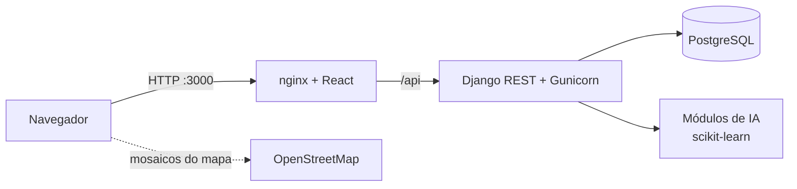

# Kaya Justa

Plataforma Inteligente de Apoio à Decisão para Arrendamento e Compra de Imóveis.
Trabalho de grupo de Laboratório de Engenharia de Software (UJC, ETSI, 3.º ano), Fase III.

## Instalação

Há duas formas de correr o sistema.

**1. Sem Docker (Windows, mais simples):** com Python 3.12+ e Node.js 20+ instalados, duplo clique em
`iniciar_sem_docker.bat`. Usa SQLite em vez de PostgreSQL, o servidor do Django (porta 8000) e o do
Vite (porta 3000). A primeira vez precisa de internet para instalar as dependências. Para parar,
feche as duas janelas que o script abre.

**2. Com Docker (ambiente de produção, secção 17.1):** Docker Desktop instalado e aberto.

| Sistema | Instalar | Parar |
|---------|----------|-------|
| Windows | duplo clique em `instalar.bat` | `parar.bat` |
| Linux / macOS | `./instalar.sh` | `./parar.sh` |

O sistema abre em <http://localhost:3000>. Contas de demonstração (palavra-passe `Demo@2026`):

| Perfil | E-mail |
|--------|--------|
| Inquilino/Comprador | inquilino@imoveis.co.mz |
| Proprietário/Agência | agencia@imoveis.co.mz, proprietario@imoveis.co.mz |
| Administrador | admin@imoveis.co.mz |

## Interface e fotografias

A interface segue os oito ecrãs do capítulo 18 do documento de Fase I/II (cores, Inter, componentes).
Rotas principais: `/` (Início e pesquisa), `/anuncios/:id`, `/meus-anuncios`, `/meus-anuncios/novo`,
`/entrar`, `/admin/moderacao`, `/admin/utilizadores`, `/admin/indicadores`.

As fotografias dos anúncios de demonstração devem ser **reais** (edifícios de Moçambique, licença livre).
Num computador com internet, corra uma vez:

```bash
python backend/anuncios/fotos_reais/descarregar_fotos.py   # Wikimedia Commons; escreve manifesto.json e CREDITOS_FOTOGRAFIAS.md
cd backend && python manage.py carregar_demo --limpar
```

Reveja as fotografias descarregadas e apague as que não servirem. Sem elas, o sistema usa imagens neutras
("Fotografia por adicionar"). No Docker, o `Dockerfile` do backend tenta o descarregamento ao construir a imagem.

**CD sem internet:** num computador com internet, corra `preparar_cd.bat` (ou `.sh`). As imagens
ficam em `imagens/kaya-justa-imagens.tar`; o `instalar` usa-as automaticamente e não precisa de internet.
O mapa (OpenStreetMap) precisa de internet; sem ela, o sistema mostra o endereço em texto (TC08).

## Assistente com IA local (opcional)

O assistente (UC09) pode responder com um modelo de linguagem que corre no próprio computador, através do
[Ollama](https://ollama.com). As regras continuam a ser a base: identificam o tema e dão ao modelo a informação
de referência (DUAT, SISA, caução...), para que os factos não venham da memória do modelo.

```bash
ollama pull qwen2.5:3b      # uma vez, cerca de 2 GB
```

Com o Ollama a correr, o assistente usa-o sozinho; sem ele, responde por regras, como antes.

| Variável | Por omissão | Função |
|----------|-------------|--------|
| `ASSISTENTE_MOTOR` | `auto` | `auto` usa o Ollama se estiver disponível; `regras` usa só as regras |
| `OLLAMA_URL` | `http://127.0.0.1:11434` | Endereço do Ollama |
| `OLLAMA_MODELO` | `qwen2.5:3b` | Modelo a usar |
| `OLLAMA_TEMPO_LIMITE` | `60` | Segundos até desistir e responder por regras |

No Docker, o Ollama do computador é `http://host.docker.internal:11434`.

## Arquitectura



| Pasta | Conteúdo |
|-------|----------|
| `backend/contas` | Autenticação e perfis (UC14, UC15, UC17), permissões, Factory |
| `backend/anuncios` | Anúncios, pesquisa, favoritos (UC01 a UC09, UC18), dados de demonstração |
| `backend/ia` | Preço justo, fraude, imagens, recomendações, assistente, Facade e Strategy |
| `backend/administracao` | Moderação, utilizadores, alertas, indicadores, parâmetros (UC10 a UC13, UC16), Observer e Singleton |
| `frontend/src` | Cliente React: páginas, componentes, menu por perfil, validação |
| `testes_interface` | Testes ponta a ponta com Playwright |

## Padrões de desenho

| Padrão | Ficheiro |
|--------|----------|
| Factory | `backend/contas/fabrica.py` |
| Strategy | `backend/ia/preco.py`, `backend/ia/risco.py` |
| Facade | `backend/ia/fachada.py` |
| Observer | `backend/administracao/sinais.py` |
| Singleton | `backend/administracao/configuracao.py` |

## Desenvolvimento e testes

```bash
cd backend
pip install -r requirements.txt
python manage.py migrate && python manage.py carregar_demo
python manage.py test          # 46 testes automáticos (casos TC)
python manage.py runserver

cd ../frontend
npm install && npm run dev     # http://localhost:3000

python testes_interface/fluxos.py   # testes de interface (com o sistema a correr)
```
